<div align="center">

# Pitlane Live

**Replay any Formula 1 race, see why it was won, and ask what would have happened with a different strategy.**

### [Open the live site →](https://pitlane-live-f1.vercel.app)

[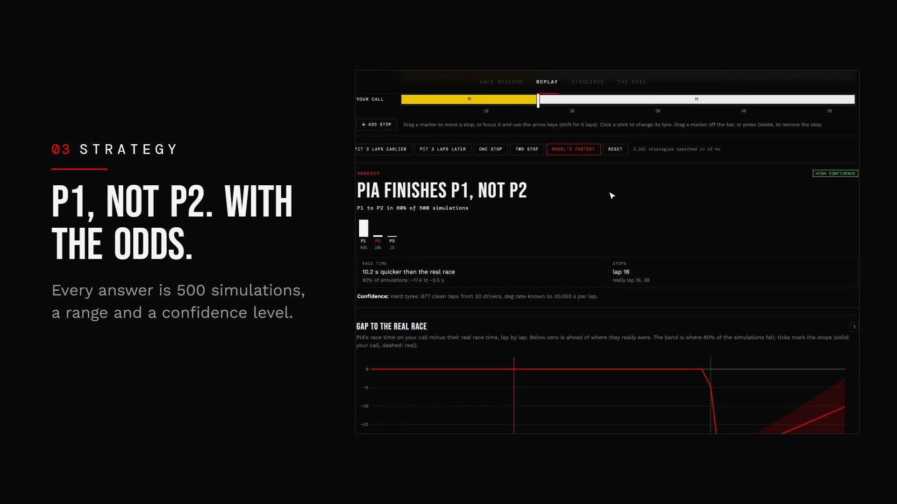](docs/media/launch.mp4)

*Click the image for the 42-second walkthrough, or watch the [20-second teaser](docs/media/teaser.mp4). How they were made: [`video/`](video/README.md).*

[](https://pitlane-live-f1.vercel.app)

[](https://vuejs.org/)
[](https://www.python.org/)
[](https://flask.palletsprojects.com/)
[](https://www.postgresql.org/)
[](https://github.com/features/actions)

</div>

---

## Contents

1. [What is Pitlane Live?](#what-is-pitlane-live)
2. [A tour of the site](#a-tour-of-the-site)
3. [The Strategy Lab, explained simply](#the-strategy-lab-explained-simply)
4. [Where the data comes from](#where-the-data-comes-from)
5. [How it is built](#how-it-is-built)
6. [Run it on your own computer](#run-it-on-your-own-computer)
7. [Engineering decisions worth reading](#engineering-decisions-worth-reading)
8. [Project structure](#project-structure)
9. [Limitations](#limitations)
10. [Credits](#credits)

---

## What is Pitlane Live?

Pitlane Live is a free website for Formula 1 fans. Every race from the start of 2024 to
the latest Grand Prix is on it (68 races so far, plus the sprint races), built from
real timing data. For every race you can:

- **Replay it.** Watch every car move around a map of the circuit, lap by lap, with the
  live timing tower, pit stops, flags and weather, at any speed.
- **Debrief it.** See who gained places, how the gaps changed, who was really fastest,
  what every pit stop cost and how quickly each tyre wore out.
- **Rewrite it.** Pick a driver, move their pit stops or change their tyres, and see
  where they would have finished. Every answer comes with an honest range and a
  confidence level, not a single made-up number.

You also get the season calendar with a countdown to the next session, standings, a page
for every driver, F1 news, and a prediction game you can play with an account.

No login is needed for any of the race pages.

---

## A tour of the site

### Home: the next race and the season

The countdown to the next session, the season calendar, and quick links to everything else.

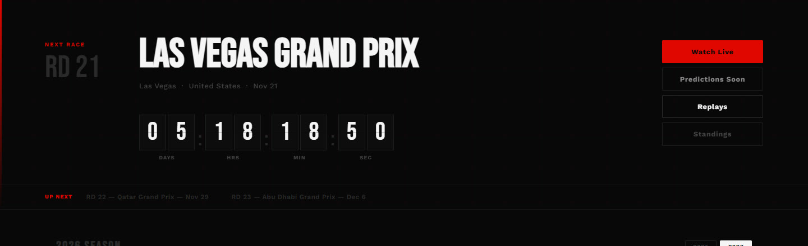

### Race Library

Every race that has been built, by season. Pick one to open its **Race Room**.

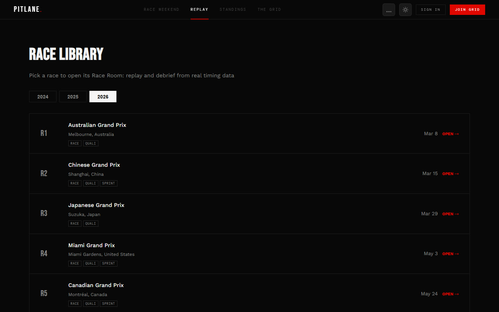

### Race Room, tab 1: Replay

The race plays back on the circuit map. The timing tower on the left shows positions,
gaps, tyres and tyre age. The timeline at the bottom marks yellow flags, Safety Cars and
every pit stop, and the feed on the right lists race events as they happen. Play, pause,
skip laps or change speed with the buttons or the keyboard.

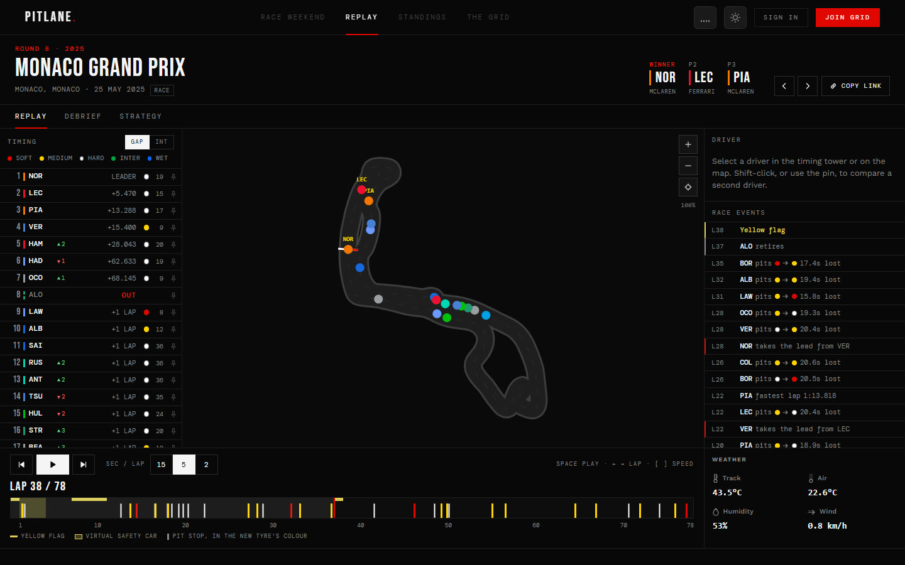

### Race Room, tab 2: Debrief

The story of the race in numbers: the winner and the margin, the biggest climber, who led
most, the fastest lap, then charts for strategy, positions, gaps, race pace and every pit
stop. Click a driver anywhere to highlight them in every chart.

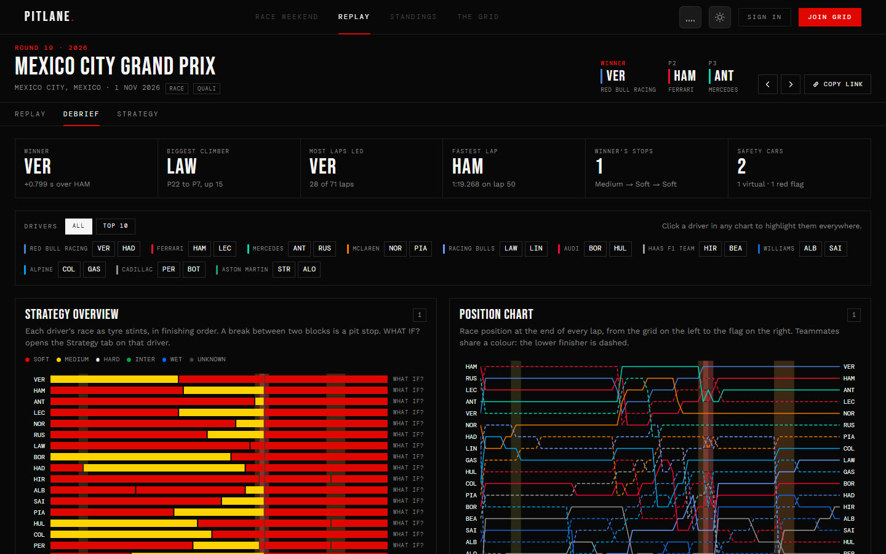

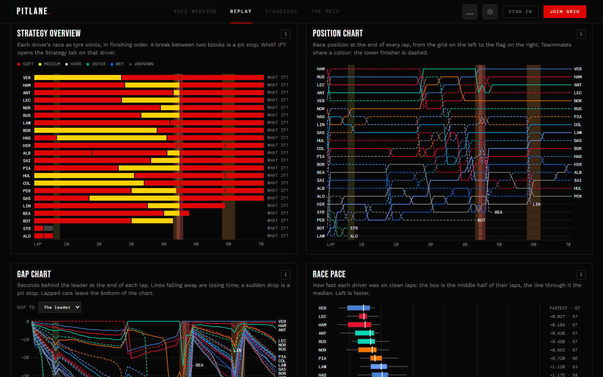

The **tyre degradation** chart shows how much time each tyre compound lost per lap as it
got older, measured from that race's own lap times.

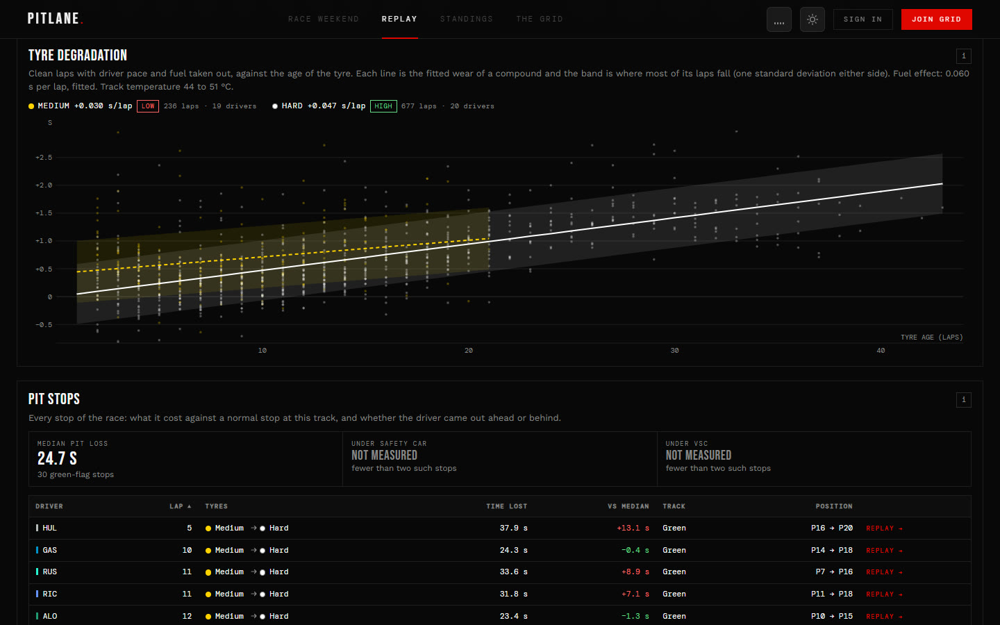

### Race Room, tab 3: Strategy (the Strategy Lab)

Pick a driver. The top bar is the strategy they really ran; the bar below is **your call**.
Drag a pit stop marker, click a stint to change its tyre, or use the preset buttons. The
verdict updates as you drag.

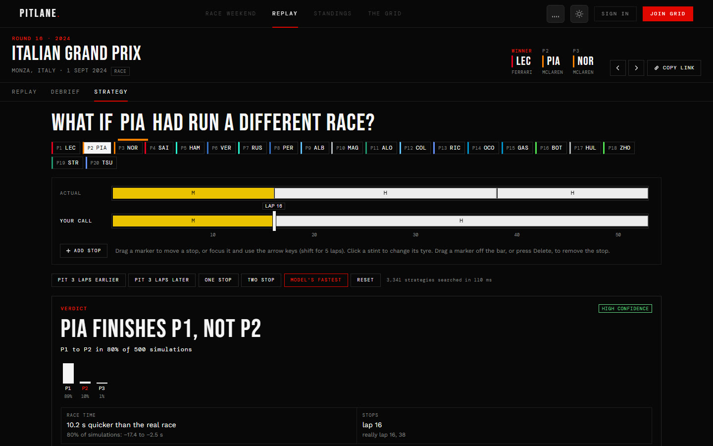

The verdict always gives a range, never a single position on its own: "P1 to P2 in 80% of
500 simulations". The bars show how often each finishing position came up.

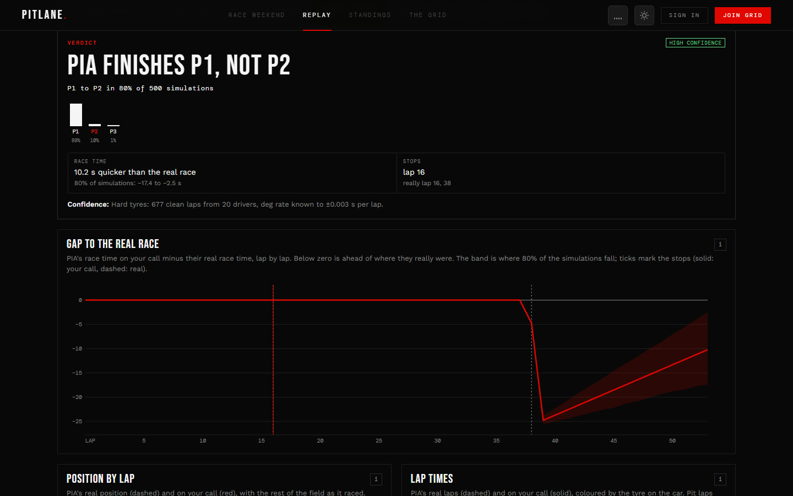

Three charts show what changed: the gap to the driver's real race lap by lap (with the
uncertainty band), their position against the field, and their lap times by tyre.

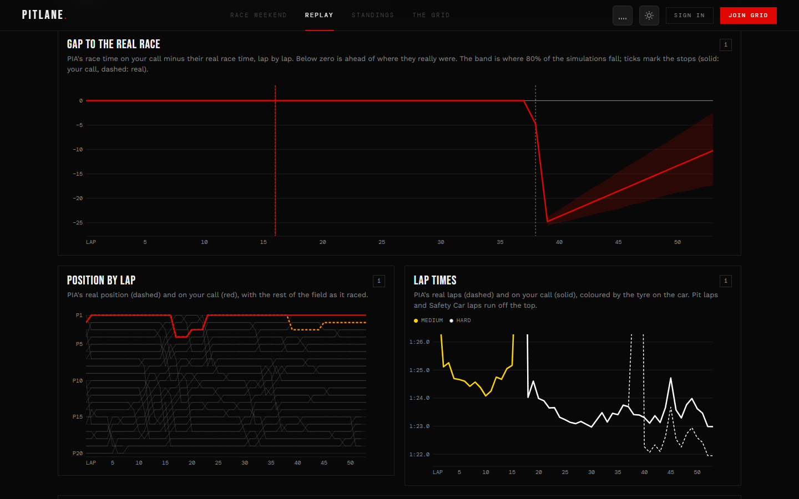

Everything the result assumes is written out on the page, always visible, together with
the "traffic risk": how many laps the driver would have spent stuck behind a slower car.

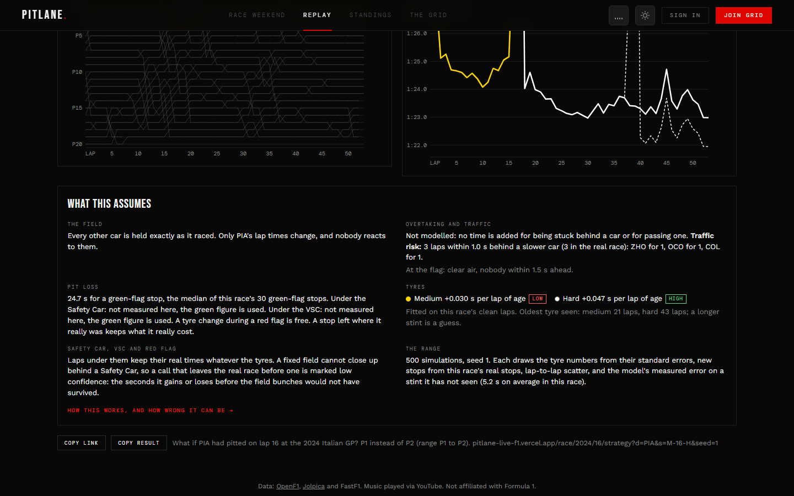

Every scenario lives in the page address, so **a copied link reopens the exact same
result**, for example
[Piastri one-stopping at Monza 2024](https://pitlane-live-f1.vercel.app/race/2024/16/strategy?d=PIA&s=M-16-H&seed=1).

Races run in the wet are refused, with the reason, because the model knows nothing about a
drying track:

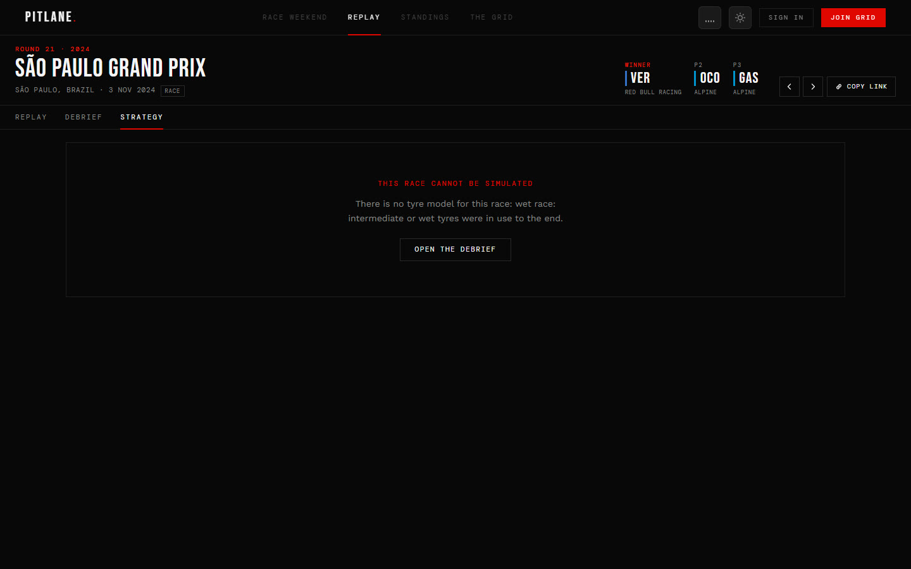

A plain-language page, [How the Strategy tab works](https://pitlane-live-f1.vercel.app/about/strategy-model),
explains the method and shows how accurate it is across every race.

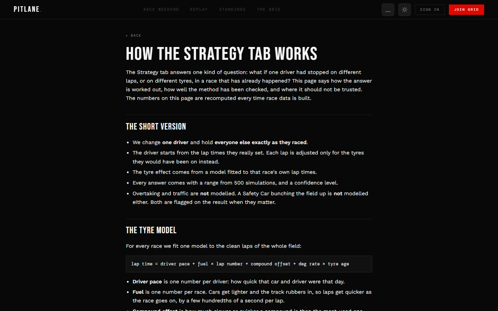

### Light theme and phones

Every page has a dark and a light theme and works on a phone.

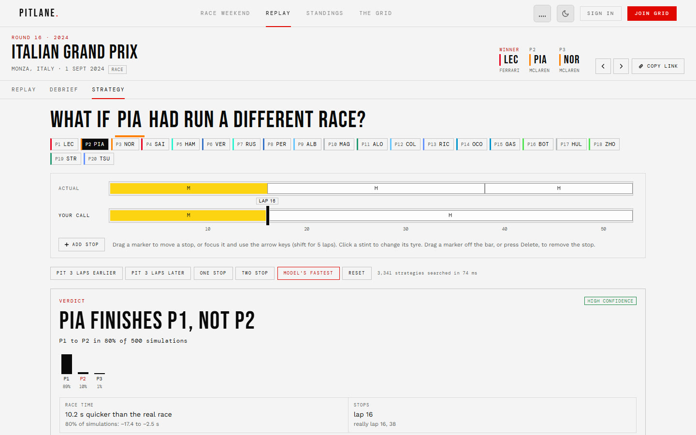

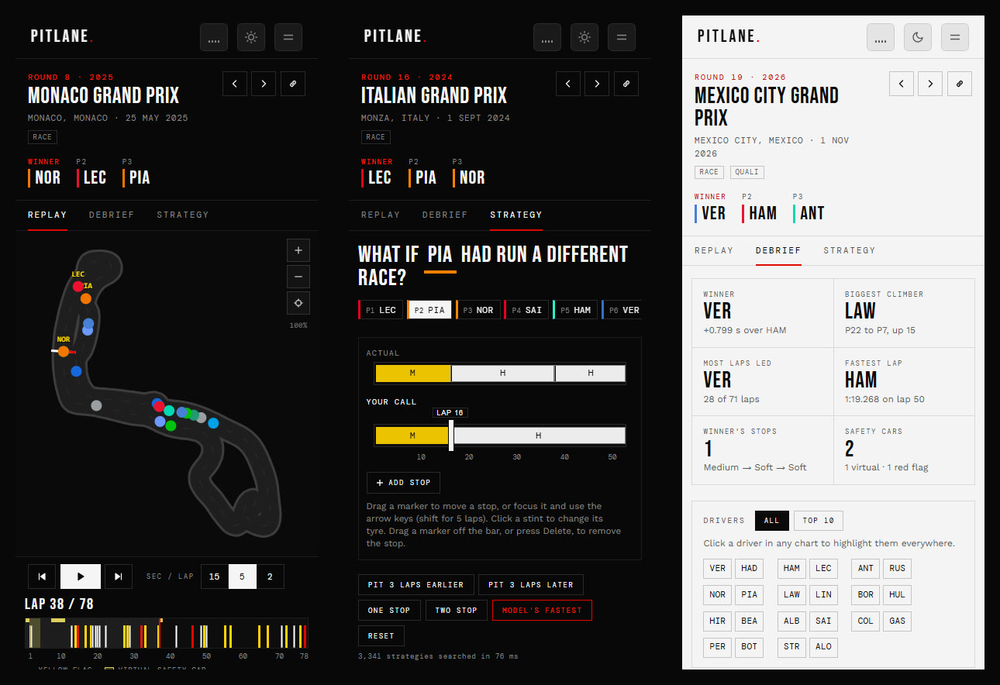

### The Grid

Every driver of the season with their stats, plus the latest F1 news.

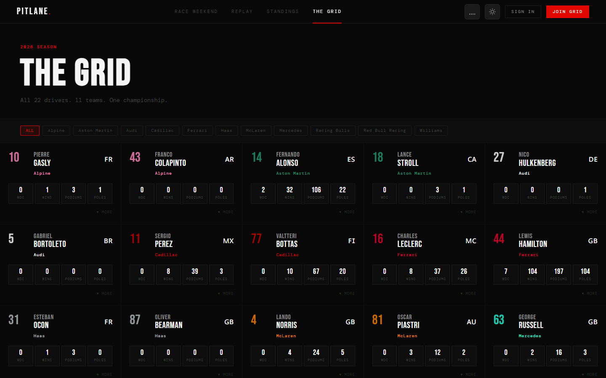

---

## The Strategy Lab, explained simply

**The question:** "What if Piastri had pitted once instead of twice at Monza?"

**Step 1: learn how the tyres behaved in that race.** For every race we fit one small
model to the clean laps of the whole field:

```
lap time = driver pace + fuel effect × lap number + tyre compound + wear rate × tyre age
```

In plain words: each driver has their own pace, every car gets a little quicker as it
burns fuel, each tyre compound has its own speed when new, and each one loses some time
for every lap it gets older. "Clean laps" means green flag, no pit stop, not the first lap,
not stuck behind a backmarker. The model is a straight line fit (least squares), nothing
more exotic, so every number in it can be checked by hand.

**Step 2: change only what the new strategy changes.** We start from the lap times the
driver really set and adjust each lap by the difference between the tyre they were on and
the tyre they would have been on:

```
new lap = real lap − model(real tyre, real age) + model(new tyre, new age)
```

So everything the model does not know stays in: the traffic they really met, their
mistakes, the wind. Pit stops are taken out and put back in at their measured cost for
that track. Laps behind the Safety Car keep their real times.

**Step 3: hold everyone else exactly as they raced** (we call it the "ghost field") and
compare the new race time with theirs, lap by lap, to get a position.

**Step 4: say how sure we are.** The model is not perfect, so we run the race 500 times,
each time drawing the tyre numbers, the pit-stop cost and the lap-to-lap scatter from how
uncertain they really are. The result is a range and a share of runs per position. A
confidence tag (high, medium, low) says how much to trust it, and low-confidence results
are shown greyed out with the reason.

**How good is it?** We test the model on drivers it has not seen: fit it without one
driver, give it only their first stint, and ask it to predict the rest of their race.

| Check across all races | Result |
|---|---|
| Races with a model | 65 of 68 |
| Races the Strategy Lab will simulate | 61 of 68 (the rest were wet) |
| Error on an unseen driver, per lap (median race) | 0.53 s |
| Error on an unseen driver, over a whole stint (median race) | 6.5 s |
| Lap-time variation explained (median R²) | 0.78 |

The full race-by-race table is in [`pipeline/model/VALIDATION.md`](pipeline/model/VALIDATION.md)
and the maths in [`pipeline/model/MODEL.md`](pipeline/model/MODEL.md).

**What it does not do**, said plainly: it does not model overtaking or traffic, nobody
reacts to the new strategy, and a Safety Car cannot close the field up behind the driver.
These are flagged on every result where they matter. See [Limitations](#limitations).

---

## Where the data comes from

```
OpenF1 API (free) ──┐
Jolpica (results) ──┼──► pipeline/build.py ──► validate ──► static JSON files ──► website
FastF1 cache ───────┘     (GitHub Actions,       (gate)      frontend/public/data/
                           every 2 h on race weekends)
```

- A **GitHub Actions** workflow ([`ingest.yml`](.github/workflows/ingest.yml)) runs every two
  hours from Friday to Tuesday on race weekends. It downloads the new sessions, builds the
  files, fits the tyre model, and commits them. Vercel then redeploys the site on its own.
- **Sources:** [OpenF1](https://openf1.org) for lap times, positions, pit stops, tyres, race
  control and weather; [Jolpica](https://jolpi.ca) for the classification when OpenF1 has not
  published it; a local [FastF1](https://docs.fastf1.dev) cache for the older races that were
  built from it. No accounts or keys are needed for any of them.
- **A validation gate** ([`pipeline/validate.py`](pipeline/validate.py)) checks every race
  before it is published: no track-status period that ends before it starts, only known
  tyre names, a believable pit-stop cost, no two cars in the same position, and a lap count
  that matches the results. A race that fails is not published.
- Every file and field is documented in [`pipeline/SCHEMA.md`](pipeline/SCHEMA.md).

Per race the pipeline writes: a replay file, every lap of every driver, the results, track
status (flags and Safety Cars), weather, the cost of a pit stop at that track, the circuit
outline, and the tyre model.

---

## How it is built

```
                ┌──────────────────────────────────────────────┐
                │  Website: Vue 3 + Vite, hosted on Vercel      │
                │                                              │
                │  Race pages read static JSON from /data/     │──── no server needed
                │  The Strategy Lab runs in a Web Worker       │     for any race page
                │  in the browser                              │
                └───────────────┬──────────────────────────────┘
                                │ /api/* (accounts, predictions, schedule, news)
                                ▼
                ┌──────────────────────────────────────────────┐
                │  API: Flask + Gunicorn (gthread), on Render   │
                └───────────────┬──────────────────────────────┘
                                ▼
                ┌──────────────────────────────────────────────┐
                │  Database: PostgreSQL on Supabase             │
                │  users, predictions, scores                  │
                └──────────────────────────────────────────────┘
```

| Part | What it uses |
|---|---|
| Website | Vue 3, Vue Router, Pinia, Vite, d3 (scales and shapes only), inline SVG and canvas |
| Strategy Lab | Plain JavaScript in a Web Worker: about 40,000 strategies searched in under 0.3 s |
| Data pipeline | Python 3.11, pandas, numpy (the tyre model is numpy least squares) |
| API | Flask, SQLAlchemy, Gunicorn with gthread workers |
| Database | PostgreSQL on Supabase (SQLite for local development) |
| Hosting | Vercel (website and data files), Render (API), GitHub Actions (data) |
| Tests | pytest (pipeline and API), Vitest (frontend: every race is checked) |

---

## Run it on your own computer

You need **Node.js 20+** and **Python 3.11**.

**1. The website** (enough for every race page; it reads the data files in the repo):

```bash
cd frontend
npm install
npm run dev
```

Open http://localhost:3000.

**2. The API** (only for accounts, predictions, standings and news). In a second terminal,
from the repository root, PowerShell:

```powershell
python -m venv .venv
.venv\Scripts\Activate.ps1
pip install -r backend/requirements.txt
$env:DATABASE_URL = 'sqlite:///local.db'
python backend/init_db.py      # creates and fills a local test database (sqlite only)
python backend/run.py          # serves on port 5000; the website forwards /api to it
```

On macOS or Linux use `source .venv/bin/activate` and `export DATABASE_URL=sqlite:///local.db`.

**3. Rebuild race data** (optional):

```bash
pip install -r pipeline/requirements.txt
python pipeline/build.py --year 2026 --round 19 --force   # one race
python pipeline/validate.py                               # check everything on disk
python pipeline/model/validate_model.py                   # rewrite VALIDATION.md
```

**Tests:**

```bash
python -m pytest pipeline -q
python -m pytest backend -q
cd frontend && npm run test
```

**Environment variables for the API** (set them on Render in production):

| Variable | What it is |
|---|---|
| `DATABASE_URL` | Database connection string. Use Supabase's Session Pooler URL in production. |
| `SECRET_KEY` | Signs login tokens. Required in production. |
| `ADMIN_KEY` | Protects the scoring endpoints the data workflow calls after a race. |
| `CORS_ORIGINS` | Comma-separated list of allowed website origins. |
| `PUBLIC_DATA_BASE_URL` | Where the API reads race files from, e.g. `https://pitlane-live-f1.vercel.app/data`. |

---

## Engineering decisions worth reading

### Race pages need no server at all
Building a race needs 1 to 2 GB of memory; the free API server has 512 MB. So the heavy
work happens once, in GitHub Actions, and the results are plain JSON files served by
Vercel's CDN. A race page never waits for the API to wake up, and the API being down
never breaks a replay.

### Change one driver, hold the field fixed
A full race simulator would need to model overtaking, which nobody can do well from timing
data alone. Instead the Strategy Lab changes one driver's lap times only by what the tyre
model says the new tyres change, and keeps everything else real. Feeding a driver's real
strategy back in returns their real race to the millisecond, which is tested on five races.

### Honest uncertainty instead of a single number
The model's measured error on a stint it has not seen (6.5 s for a typical race) is bigger
than many strategy calls, so a single "3 s quicker" would be misleading. Every result is
500 seeded simulations with a range, a position histogram and a confidence tag, and the
page opens on a result the model can stand behind.

### Fix data at the source, then gate it
The previous version of the site had negative flag times, phantom pit stops on lap 1,
unknown tyre names and two cars in the same position. Each was traced to its cause in the
data adapters and fixed there, with a test per fix, and the validation gate now stops any
such race from being published again.

### gthread over gevent
On Render, gevent's monkey-patching ran after urllib3 and PyJWT had imported the unpatched
SSL module, which caused infinite recursion. gthread uses real threads and no patching:

```
gunicorn --worker-class gthread --workers 1 --threads 4 --bind 0.0.0.0:$PORT run:app
```

### Atomic writes
Every data file is written to a `.tmp` file and then moved into place with `os.replace()`,
so a reader never sees half a file.

### Supabase Session Pooler
Supabase's direct connection is IPv6 only and Render's free tier is IPv4 only. The Session
Pooler URL bridges the two without any code change.

### Infrastructure history
The first version ran on an Azure VM (Gunicorn with gevent behind Nginx, SQLite, FastF1 on
the VM). When the student credits ran out it moved to Render and Supabase, and race data
moved from on-demand processing to the pre-built files described above.

---

## Project structure

```
pitlane-live/
├── frontend/                     Vue 3 website (Vercel)
│   ├── public/data/              Race data built by the pipeline (one folder per race)
│   └── src/
│       ├── views/                Pages: Home, RaceLibrary, RaceRoom, Standings, TheGrid, ...
│       ├── components/race/      Race Room tabs: ReplayTab, DebriefTab, StrategyTab
│       ├── components/charts/    Debrief and Strategy charts
│       ├── components/strategy/  Strategy editor and verdict card
│       ├── lib/                  raceClock (replay), debrief, strategySim, tyreModel
│       └── content/              The "How the Strategy tab works" page (Markdown)
├── pipeline/                     Race data builder (Python)
│   ├── build.py                  Builds every file of a race
│   ├── validate.py               The validation gate
│   ├── sources/                  OpenF1 and FastF1 adapters
│   ├── model/                    Tyre model, its validation, MODEL.md, VALIDATION.md
│   └── SCHEMA.md                 Every data file, field by field
├── backend/                      Flask API (Render): accounts, predictions, scoring, schedule
├── docs/                         README screenshots and the launch videos
├── video/                        How the launch videos are made: footage recorder, music, Remotion project
└── .github/workflows/ingest.yml  Builds and publishes new races on race weekends
```

---

## Limitations

- **Overtaking and traffic are not modelled** in the Strategy Lab. The result reports how
  many laps the driver would have spent behind a slower car, but does not turn that into time.
- **Nobody reacts.** In a real race the car ahead covers an undercut; here it does not.
- **Safety Cars:** the field cannot bunch up behind the driver, so a strategy that changes
  something before a Safety Car is marked low confidence.
- **Tyre management:** wear rates are those of tyres driven the way drivers chose to drive
  them. A tyre pushed harder would wear faster.
- **Wet races are not simulated.** 7 of the 68 races are refused for this reason.
- **"Model's fastest"** is the model's best guess and also finds the model's own errors.
  Treat it as something to look at, not proof that a team got it wrong.
- Race data appears a few hours after a race, once OpenF1 has published it.

---

## Credits

Data from [OpenF1](https://openf1.org), [Jolpica](https://jolpi.ca) and
[FastF1](https://docs.fastf1.dev). Pitlane Live is an unofficial fan project and is not
associated with Formula 1, the FIA or any team. F1, FORMULA ONE and related marks are
trademarks of Formula One Licensing B.V.

*Built by [Ishaan Goswami](https://github.com/Ishaan2510), CS undergraduate at PDEU and IIT Madras.*
